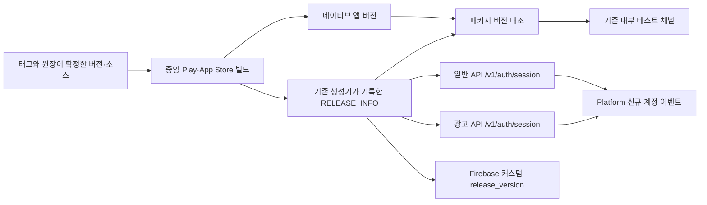

# 모바일 가입과 분석 이벤트의 출시 버전 전달

- 설계 `mobile-release-version` v1, 사람 검토 대기
- 조사 기준 Happy Farm `9999df19708dc405e4ea27678444cdfe606a6734`, 중앙 `.github` `b112d6340afc8e2f36dbb994f324933fb6ef0405`
- 기준 릴리스 `v1.13.1` (`a8fb296b20c48be3501b7879ef8a85c6cc86e034`). [Play 공개 기록](../../qa/2026-11-06-mobile-reward-public/README.md)과 11월 19일 [한국 App Store 조회](https://itunes.apple.com/lookup?id=6775451733&country=kr)에서 버전을 확인했다.
- 관련 [리텐션 계측 #580](https://github.com/seorilabs/happy-farm/issues/580), [앱인토스 중계 #212](https://github.com/seorilabs/platform/issues/212)

## 목적과 범위

Android·iOS에서 처음 열린 Platform 계정이 정확한 출시 버전으로 기록되고, 같은 빌드의 GA4 커스텀 이벤트 `release_version`이 네이티브 표시 버전과 일치해야 한다.

| 관측 | 원인 | 수락 결과 |
| --- | --- | --- |
| 신규 계정 알림이 `제공 안됨`으로 표시될 수 있다. | 일반 API와 광고 API가 동시에 `/v1/auth/session`을 호출한다. `v1.13.1`과 SDK 0.6.0의 모의 실행에서 광고 요청에 `X-Seori-AppVer`가 없었다. 광고 쪽이 먼저 계정을 생성할 경우 최초 요청의 속성으로 신규 계정 이벤트가 만들어진다. | 두 요청 모두 동일한 버전을 보내고 어느 쪽이 계정을 먼저 만들어도 신규 계정 이벤트의 `appVersion`이 정확하다. |
| 11월 7~18일 GA4에서 네이티브 버전 `1.13.1`의 커스텀 이벤트 45,525건이 `release_version=0.0.0`이었다. | 실제 Play·App Store 워크플로는 네이티브 버전만 설정했다. 모바일 JS는 저장소에 커밋된 개발 기본값을 읽었다. | 같은 태그의 AAB·IPA가 정확한 JS 버전을 포함하고 Firebase 커스텀 이벤트가 그 값을 사용한다. |

범위는 Happy Farm의 모바일 플랫폼 조합 지점, 기존 버전 생성기와 마켓 워크플로 호출부, 중앙 RN 빌드 워크플로의 선택 입력이다. 광고 보상과 검증 정책, 계정 매핑과 신규 이벤트 중복 방지, GA4 이벤트 이름과 기존 측정도구, 제품 화면·마켓 목록 문구는 현행 계약을 따른다. 이미 수집된 운영 이벤트는 보고서에서 Firebase의 `app_info.version`으로 확인한다. 개별 알림의 최초 요청은 관측 근거가 없어 소급 보정 대상에서 제외한다.

## 데이터 흐름과 책임

1. 중앙 Play·App Store 워크플로의 기존 `prepare_script` 단계에 검증된 중앙 값을 전달한다. Happy Farm 호출부는 기존 `scripts/write-release-info.mjs`를 지정한다. 네 값은 `SEORI_RELEASE_TAG`, `SEORI_RELEASE_VERSION`, `SEORI_RELEASE_VERSION_CODE`, `SEORI_RELEASE_SOURCE_SHA`다. 표기 버전은 태그 바인딩의 `version_name`이고 Android의 숫자는 원장의 Android versionCode를 쓴다. iOS의 JS `buildNumber`는 기존 중앙 iOS 런타임 코드 계약을 재사용하고, `CFBundleVersion`은 기존 Apple build number로 확인한다. 앱 저장소에서 마켓 번호를 다시 계산하지 않는다.
2. `apps/mobile/src/platformEvents.ts`의 일반 API·광고 API 클라이언트에 `RELEASE_INFO.versionName`을 공급하는 공통 `clientContext`를 사용한다. SDK의 버전 헤더 경로와 기존 이벤트 `eventContext`를 재사용한다. 동시에 인증하는 방식, 광고 세션 분리, 실패 반환과 디버그 표시 규칙은 현행 동작을 검증한다. GA4 어댑터는 생성된 `RELEASE_INFO.versionName`을 그대로 읽는다.
3. 태그를 checkout한 마켓 잡에서 준비 단계가 누락·빈 값·`0.0.0`·태그/소스/표시 버전 불일치를 발견하면 번들링 전에 실패한다. 빌드 뒤 업로드 전에 검증을 선택한 호출부는 패키지의 네이티브 메타데이터와 해당 빌드의 Metro 소스맵에 포함된 `releaseInfo.ts`를 중앙 바인딩과 대조한다. 패키지 안의 JS 번들 해시를 같은 잡에서 만든 번들의 해시와 비교해 이전 번들이 섞이는 경우를 잡는다. Android는 AAB, iOS는 archive와 최종 export의 JS 번들을 읽는다. 사전 생성 파일만 맞거나 출처를 확인할 수 없는 소스맵만 있으면 실패한다. 중앙 선택 단계의 기본값은 기존 호출부 동작이며, 빌드 증적에는 값과 해시만 기록한다.

중앙 워크플로가 두 마켓에서 같은 버전 계약을 제공하므로 별도 네이티브 모듈로 버전을 다시 읽거나 Backoffice에서 추정값을 채울 필요가 없다. 시범 검증에서 소스맵과 실제 패키지의 결속을 입증할 수 없으면 그 검증 조건을 빼고 진행하지 않는다. 해당 단계의 실패 근거를 제시하고 설계를 재검토한다.

## 인수조건과 L3 계획

| ID | 확인할 동작 | 실행과 수락 근거 |
| --- | --- | --- |
| AC-1 | 두 세션의 버전 일치 | 출시 어댑터와 SDK 0.6.0으로 Android·iOS 각각의 HTTP 요청을 실행한다. 일반 API 선착, 광고 API 선착, 기존 계정, 한쪽 실패, 토큰 없음, 동시 호출을 시험한다. 두 유효 요청의 헤더가 정확하고, 계정 생성 모의 원장에서 최초 요청에만 버전이 있는 알림이 한 건 남는다. 운영 인증·알림 전송은 대체 경계로 검증한다. |
| AC-2 | 생성기와 마켓 빌드 결속 | 태그·소스·마켓 번호가 다른 fixture, 누락 입력, `0.0.0`, 이전 JS가 들어간 패키지가 모두 업로드 전에 실패해야 한다. iOS 런타임 코드와 Apple 번호가 다른 경우도 검증한다. 신규 입력을 사용하지 않는 중앙 호출부와 기존 AIT 버전 생성 경로도 회귀 확인한다. |
| AC-3 | 이벤트 필드와 업데이트 판정 일치 | 생성된 출시 버전으로 Android·iOS 앱 시작과 첫 수확을 실행한다. Firebase `game_start`, `first_meaningful_harvest` 및 기존 Platform 게임 이벤트에서 `release_version`이 같아야 한다. 중복 전송과 디버그 표시, 실제 버전으로 설정을 조회할 때의 업데이트 안내·정상 진입을 검증한다. GA4가 생성하는 자동 이벤트는 Firebase의 네이티브 버전 필드로 확인한다. |
| AC-4 | L3 전체 회귀 | 구현과 다른 에이전트가 같은 후보 SHA, 격리 저장소와 SDK 대체 경계로 아래 26개 기능을 실행한다. 기능별 근거와 실패, 미실행을 기록한다. 정적 CI와 워크플로 계약 검사는 병행한다. |
| AC-5 | 정확한 후보의 테스트 채널 도달 | 중앙 `before-build`, `before-deploy`를 각 마켓에서 통과한다. 태그 바인딩, 업로드 산출물, Play 내부 트랙의 `completed` 및 versionCode, App Store Connect 빌드의 `VALID` 및 기존 내부 그룹 제공 여부를 확인하고 내부 링크를 전달한다. |

| 회귀 실행 | 기능 목록 ID |
| --- | --- |
| 새 저장으로 시작, 첫 수확, 심기, 성장 후 수확, 업그레이드, 복귀 요약, 저장 복원 및 초기화 | `app-launch-shell`, `title-startup`, `onboarding`, `planting`, `growth-harvest`, `shop`, `welcome-back-offline`, `save-restore`, `reset-farm` |
| HUD 목표, 메뉴·시트, 미션·출석·룰렛·도감, 생산, 연구·자동화, 프레스티지·지도·랜드마크, 설정 | `hud-goals-status`, `menus-sheets`, `missions`, `daily-bonus-wheel`, `collection-achievements`, `production`, `research-automation`, `prestige-map-landmark`, `settings` |
| 보상·전면 광고, 동의·알림 및 모바일 시작의 Platform·Firebase 경계, 버전 정책과 릴리스 증적 | `rewarded-ads`, `interstitial-ads`, `ad-consent`, `notifications`, `firebase-auth-analytics`, `platform-session-events`, `update-gate`, `release-observability` |

공통·모바일·앱인토스의 현행 테스트와 RN 개발 실행에서 조합 동작을 확인한다. 기본 검사 명령은 `pnpm lint`, `pnpm typecheck`, `pnpm test`, `pnpm check:i18n`, `pnpm check:balance`, `pnpm check:admob-analytics`, `pnpm --dir apps/mobile test --watchAll=false`, `pnpm --dir apps/ait test`다. 기존 테스트로 수락 조건이나 기능 여정이 확인되지 않는 구간은 개발 실행에 추가한다. 출시 빌드와 별도로 개발 환경은 로컬 저장소, 고정 시계와 모의 SDK/HTTP로 실행한다. 화면 개편이나 새 네이티브 SDK는 범위에 없다.

Happy Farm 기능 목록은 v1이라 독립 에이전트가 L3 실행을 맡는다. 정적 CI 결과는 보조 근거로 남긴다. 독립 실행자가 후보 SHA와 실제 실행 시각, 시나리오, 증적을 기록하며 실행 근거는 같은 SHA에서 168시간 유효하다. 기반 기능은 전부 다시 실행한다. `test-plan.json`의 `floorOverrides`는 변경 경로가 걸리는 v1 실기기 하한의 대체 근거이며, 개발 실행과 산출물 점검으로 판정한다.

## 적용과 복구

설계 승인 → 중앙 워크플로 준비·검증 계약 변경과 검토 → Happy Farm 구현 및 PR → 같은 최종 SHA의 독립 L3 → 중앙 원장의 신규 patch 태그와 근거 결속 → Play·App Store 개별 빌드 → 두 내부 테스트 채널 조회 순서로 진행한다. 기존 러너와 인증 경로를 사용하고 실제 배포 실행의 중앙 워크플로 SHA를 기록한다. `release.until`은 `test-track`이며 마켓은 `google-play`, `app-store`다. Play production과 App Store 심사, 앱인토스 배포는 별도 출시 범위다.

어느 한 채널에서 태그·소스·산출물 버전 또는 그룹과 트랙 식별이 어긋나면 해당 후보의 업로드 또는 완료 기록을 멈춘다. 문제를 고친 뒤 새 후보로 다시 검증하며 기존 태그는 이동하지 않는다. 배포 이후 관측된 신규 계정과 GA4 이벤트가 있으면 채널 표식 유무와 실제 버전을 운영 근거로 남긴다. 표본이 없으면 관측 대기로 기록한다.

## 앱인토스 점검 기록

11월 19일 [Platform #212](https://github.com/seorilabs/platform/issues/212)의 증상을 운영 Firestore `apps/happy-farm`에서 확인했다. `features.events=true`이고 수집 허용 이벤트는 17개다. `game_start`는 허용하지만 `ait_first_touch`, `ait_session_start`, `ad_load_result`는 허용 목록에 없다. `ga4.measurement_id`가 비어 있어 [중계 구현](https://github.com/seorilabs/platform/blob/e317e81524f70560e17dbe3f6646eec6afae377e/server/internal/events/ga4.go)은 전송을 건너뛴다.

11월 14일 [Platform 운영 배포](https://github.com/seorilabs/platform/actions/runs/43553709295/job/132322858565)의 GA4 시크릿 참조 검사는 통과했다. 현재 revision 직접 조회는 `run.services.get` 권한 부족으로, Platform 이벤트 원장 조회는 BigQuery 403으로 차단됐다. `happy-farm`용 시크릿 매핑과 실제 ingest 수락 건수는 미확인이다.

#212의 다음 검증은 WEB 스트림과 앱별 시크릿 매핑을 대조하고, 인증과 ingest 수락을 거친 첫 접속·세션·광고 로드 이벤트가 BigQuery WEB에 도달하는지 확인하는 것이다. 첫 접속 플래그는 전송 전에 저장되므로 복구 검증에는 격리한 신규 저장을 쓰고 기존 설치를 새 코호트로 집계하지 않는다. 레지스트리·시크릿·GA4 설정 변경과 앱인토스 업로드는 별도 승인 범위다.
