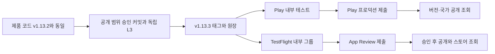

# 해피팜 v1.13.3 모바일 공개

[모바일 가입과 분석 이벤트의 출시 버전 전달 설계 v1](../2026-11-19-mobile-release-version/design.md)을 공개 단계로 이어간다. 제품 코드 기준은 `v1.13.2`와 같은 `4208f2745c239e7695dde8cc4b447024fb17cb94`다. 해당 태그의 보관된 Android·iOS 빌드는 내부 테스트 범위로 유지한다. 공개 계획을 포함한 새 후보에 `v1.13.3`을 발급한다.

## 변경 및 공개 범위

- 이용자가 실행할 코드는 이전 내부 테스트 후보와 동일하다. 가입 요청의 출시 버전과 Firebase Analytics 및 Platform 이벤트의 버전 전달 수정이 이번 공개에 포함된다.
- 대상은 Google Play와 Apple App Store다. 기존 패키지, 번들 ID, 국가, 가격, 개인정보 답변을 적용한다. Play는 전체 출시, App Store는 현재 승인 뒤 자동 공개 설정을 적용한다. 앱인토스 이벤트 점검은 [Platform #212](https://github.com/seorilabs/platform/issues/212)에서 관리한다.
- 원장이 발급한 버전과 빌드 번호를 두 마켓 산출물 및 배포에 사용한다. 출시 노트는 이전 공개 버전과의 실제 제품 차이에 대한 [v1.13.2 내부 테스트 노트](https://github.com/seorilabs/happy-farm/releases/tag/v1.13.2)의 검수 문구를 새 태그에 사용한다. 각 마켓의 모든 활성 로케일과 저장값을 제출 전에 확인한다.

## 인수조건과 테스트

1. 공개 후보의 제품 파일이 기준 SHA와 일치한다. 공개 범위는 [테스트 계획](test-plan.json)에서 확인한다.
2. 같은 최종 후보에서 독립 L3 개발 환경 검증으로 이전 설계의 인수조건 전체와 공통·모바일·앱인토스 회귀를 확인한다. [이전 테스트 계획](../2026-11-19-mobile-release-version/test-plan.json)의 기준선과 실기기 대신 개발 환경 및 산출물을 사용하는 사유를 유지한다.
3. 출시 아티팩트의 실제 내장 JS 및 네이티브 버전, 서명·업로드 결과를 원장과 대조한다. Play 내부 테스트와 TestFlight 내부 그룹에 같은 후보가 도달했는지 마켓에서 확인한다.
4. 시장별 중앙 `before-release`를 통과한 후보만 제출한다. Play 버전 코드와 App Store 빌드 번호, 기존 국가 및 공개 방식, 접수 상태를 마켓에서 다시 읽는다.
5. 심사 통과 후 공개 버전과 스토어 목록을 조회한다. 제출, 승인, 공개를 따로 기록한다. 출시 중 결함이 확인되면 해당 마켓 승격을 멈추고 후보와 증적을 보존한다. 이미 공개된 경우 필요 작업과 영향 범위를 확인한다.

## 승인

2026년 11월 20일 사용자가 같은 제품 코드를 다시 빌드해 Google Play·App Store 공개까지 진행하는 질문에 **“v1.13.3으로 공개 진행”**이라고 답했다. 새 후보를 Android·iOS 내부 테스트와 각 마켓의 심사, 공개까지 진행하는 승인이다.
