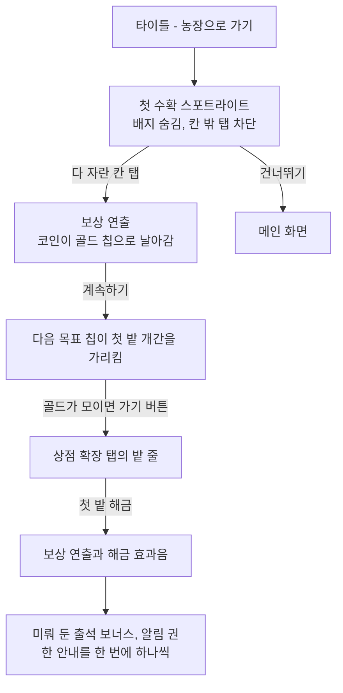
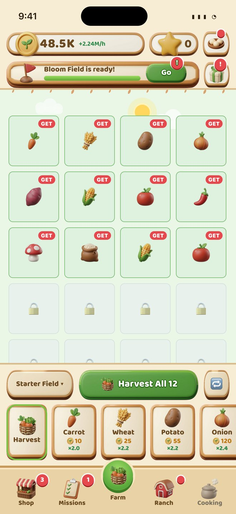
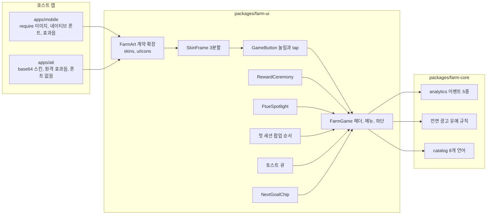

# 첫 세션 개선과 게임다운 메인 화면

- 설계 `game-ui-first-session` v1, 승인 2026-11-26 (B안 선택)
- 조사 기준 Happy Farm `7a6004b25703085c31e876f449908cb61802b91e`(main), 기준 릴리스 `v1.13.3`
- 계획 승인 2026-11-26. `/plan` 승인은 구현 승인이 아니다. 이 문서, 시안 선택과 [test-plan.json](test-plan.json)을 함께 승인받은 뒤 착수한다.
- 관련 방향 [Warm Wood 메인 화면](../../ui/main-screen-direction.md), [타이틀](../../ui/title/title-direction.md), [오버레이 생명주기](../2026-10-23-ui-overlay-lifecycle/design.md)

## 목적과 범위

신규 사용자가 첫 15초 안에 첫 수확을 끝내고, 첫날 안에 첫 밭 해금까지 가게 한다. 그 과정에서 앱처럼 보이는 메인 화면의 크롬을 게임 화면으로 바꾼다. 밭 격자(타일 배치, 성장 단계, 잠금, 수확 가능 표시)는 건드리지 않는다.

### GA4 근거

BigQuery `happy-farm-tycoon.analytics_539626577`, 2026-09-27~11-25. 스토어 설치(`install_source` iTunes, Play)만 남기고 로보 단말, 수동 설치 개발 빌드, 비정상 버전(1.1.4, 1.8.x)을 뺐다. 표본은 11-22까지 첫 실행한 신규 76명(중국 21, 일본 15, 미국 13, 한국 12명 순)이다. 표본이 작고 비교는 상관관계다. 앱인토스(WEB)는 사용자가 2명뿐이라 뺐다. 쿼리는 구현 PR에서 `analytics/queries/first-session-funnel.sql`로 남긴다.

| 구간 | 관측 | 이번 변경 |
|---|---|---|
| 첫 15초 | 19명(25%)이 온보딩을 끝내지 못했다. 첫날 참여 시간 중앙값 13초, 1~3일 내 복귀 0명 | 수확 단계 스포트라이트 |
| 수확 단계 | 19명 중 8명은 다 자란 밭을 끝내 누르지 않았다. 2명은 밭 대신 미션 시트나 광고 제안을 열었다. 시작 화면에 Shop 3, More 5 배지가 있다 | 온보딩 중 배지 숨김, 밝힌 칸 밖 탭 차단 |
| 첫 업그레이드 | 첫날 밭을 해금한 38명의 복귀율 44.7%, 해금하지 않은 38명 2.6%. 해금 시점 중앙값 175초 | 다음 목표 칩 |
| 메타 시스템 | 첫날 미션·생산·동물 중 하나라도 연 52명의 복귀율 34.6%, 하나도 열지 않은 24명 0% | 핵심 메뉴를 아이콘 버튼으로 꺼냄 |
| 첫 1분 | 온보딩 완료 15초, 일일 보너스 자동 팝업 15초, 광고 제안 48초(중앙값) | 첫 세션 팝업 순서 |
| 전면 광고 | 26명이 첫날 약 3분 만에 전면 광고를 봤고 대부분 `harvest_batch`였다 | 첫 밭 해금 전이거나 첫 10분 안이면 미노출 |
| 계측 | 상점·랩·설정·룰렛 진입, 시트 닫힘 이벤트가 없다 | 진입 경로와 체류 이벤트 추가 |

### 사용자 결정 (2026-11-26)

| 항목 | 결정 |
|---|---|
| 범위 | 메인 화면, 첫 세션, 잦은 보상. 시트 12종 개별 재스킨은 다음 차수 |
| 서체 | 숫자와 라틴 문자만 Baloo 2. 한중일은 시스템 굵은 글씨와 외곽선. 앱인토스는 외곽선 방식 |
| UI 밖 | 개편 효과 계측, 첫 세션 전면 광고 유예 |
| 끝 지점 | Google Play, App Store, 앱인토스 공개 |
| 레이아웃 | **B안: 하단 탭 바** (2026-11-26 사용자 선택) |

### 포함과 제외

| 포함 | 제외 |
|---|---|
| 헤더, 재화 칩, 다음 목표, 메뉴, 하단 도구 영역의 구조와 스킨 | 밭 타일, 잠금 칸 접기, 밭 영역 배경색 |
| 시트 컨테이너 모션, 공통 버튼 눌림과 효과음, 토스트 큐 | 시트 12종(`WheelSheet`, `LabSheet`, `ChainMapSheet`, `CookingSheet` 등)의 개별 재스킨 |
| 보상 연출(미션, 출석, 오프라인, 광고 보상, 숙련, 졸업) | 새 재화, 새 콘텐츠, 경제 수치 |
| 첫 수확 스포트라이트, 첫 세션 팝업 순서 | 타이틀 화면 |
| 계측 5종, 전면 광고 유예 | 앱인토스 커스텀 폰트, 태블릿 전용 레이아웃 |

## 사용자 흐름과 화면 상태

| 상태 | 표현 |
|---|---|
| 온보딩 중 | 화면을 어둡게 하고 다 자란 칸 하나만 밝힌다. 손가락 포인터와 한 줄 말풍선, 건너뛰기 링크. 메뉴 배지는 숨긴다 |
| 15초 무행동 | 기존 stall 넛지를 스포트라이트 펄스로 바꾼다. `onboarding_stall`은 그대로 발화한다 |
| 보상 | 딤, 나무 패널 팝업, 리본 제목, 코인 버스트, 숫자 카운트업, 확인 버튼 하나. 코인이 실제 HUD 골드 칩까지 날아간다 |
| 목표 진행 중 | 아이콘, 진행 막대, 남은 금액 |
| 목표 달성 가능 | 초록 가기 버튼에 느낌표 배지와 튕김 |
| 기능 잠김 | 회색 아이콘과 자물쇠 배지. 해금되면 NEW 리본 |
| 버튼 눌림 | 아래 두께가 줄고 요소가 같은 양만큼 내려앉는다. 탭 효과음 20~40ms |
| 비활성 | 무채색 스킨과 낮은 대비. 색만으로 상태를 전하지 않는다 |
| 작은 화면, 큰 글자 | 750×1334(iPhone SE)와 fontScale 2에서 버튼 글자가 넘치지 않는다. 긴 독일어 문구는 줄을 바꾸거나 줄임표를 쓰고 접근성 라벨에 전체 문구를 둔다 |

### 시안

같은 장면 세 개(진행된 메인 화면, 첫 수확 스포트라이트, 첫 수확 보상)를 두 레이아웃으로 그렸다. 밭 격자 부분은 현재 main의 실제 실행 캡처다. 비교 페이지는 로컬 `~/Pages/2026-11-26-happy-farm-game-ui/index.html`이다.

사용자는 **B안**을 골랐다. 기준 이미지는 [메인](../../ui/reference/game-ui/B-main-en.jpg), [한국어](../../ui/reference/game-ui/B-main-ko.jpg), [첫 수확](../../ui/reference/game-ui/B-ftue-en.jpg), [보상](../../ui/reference/game-ui/B-reward-en.jpg), [작은 화면](../../ui/reference/game-ui/B-main-se.jpg)이다. 재현 소스 `docs/ui/reference/game-ui/mock.html`은 `assets/art/ui/`의 아이콘·스킨과 실행 캡처를 `../images/`로 읽는 목표 외형 기준이며 제품 코드가 아니다.

| | A안: 아이콘 메뉴 줄 | B안: 하단 탭 바 |
|---|---|---|
| 상단 | 재화 칩(골드, 별)과 설정, 다음 목표 칩, 그 아래 아이콘 메뉴 6개(상점, 미션, 목장, 요리, 출석, 더보기) | 재화 칩(골드, 별)과 더보기, 다음 목표 칩과 출석 버튼 |
| 하단 | 모두 수확(primary)과 재심기(secondary), 구역 탭, 씨앗 카드 | 구역 선택 칩, 모두 수확, 재심기 아이콘, 씨앗 카드, 하단 탭 바(상점, 미션, 농장, 목장, 요리) |
| 밭이 보이는 높이 | 약 444pt(현재 약 403pt) | 약 514pt |
| 장점 | 현재 배치와 가까워 기존 사용자가 덜 낯설다. 구역 탭이 그대로 보인다 | 상용 농장 게임의 하단 탭 문법이라 가장 게임답다. 밭이 더 크게 보인다 |
| 위험 | 상단이 여전히 세 덩어리다 | 구역을 고르려면 한 번 더 눌러야 한다. 하단 높이가 크다 |

## 구조와 책임

- 재사용: 수확 입자(`FarmGame.tsx:8808`), `HarvestPopText`(8714), `pulseGold`(1423), 외곽선 글자(`FarmStartup.tsx:130-155`), 타이틀 아트 base64 패턴(`titleArt.generated.ts`, `pnpm check:title-art`), stall 넛지(2646), `ui-overlay-lifecycle`의 오버레이 규칙.
- 새 네이티브 의존성은 넣지 않는다. 그라데이션과 9분할 라이브러리 대신 PNG 3분할을 View 세 개로 조립한다. RN `Image`의 `capInsets`는 iOS 전용이라 쓰지 않는다.
- `scripts/check-architecture.mjs`의 farm-ui import 규칙과 `scripts/check-ait-runtime-compat.mjs`를 지킨다.

## 데이터, 인터페이스, 실패 처리

| 항목 | 내용 |
|---|---|
| 저장 | 새 저장 필드는 없다. 첫 밭 해금 여부는 기존 `plots` 수로, 첫 세션 경과는 기존 세션 시각으로 판단한다. 온보딩 단계 계약(`ONBOARDING_STEPS`)은 바꾸지 않는다 |
| 원격 설정 | `ad_limits`에 `interstitialFirstSessionGraceMs` 기본값 600000을 더한다. 값이 없거나 깨지면 기본값을 쓴다 |
| 계측 | `sheet_opened`(sheet, source), `sheet_closed`(sheet, dwell_ms), `nav_tapped`(target), `ftue_pointer_shown`(step), `goal_chip_tapped`(goal_kind, ready). 기존 공통 context를 붙이고 파라미터 25개 상한을 지킨다 |
| i18n | 새 문구와 바뀌는 문구는 8개 locale을 함께 고친다. 금액 뒤 `G`(예: 48.5KG)는 코인 아이콘으로 바꾼다. catalog에 박힌 이모지 아이콘은 아이콘 이미지로 옮긴다. 저장 데이터에는 번역 문자열을 넣지 않는다 |
| 에셋 실패 | 스킨 이미지를 못 읽으면 지금의 코드 스타일 View로 그린다. 아이콘을 못 읽으면 기존 이모지를 쓴다. AIT 원격 효과음이 없으면 무음으로 둔다 |
| 연출 중 입력 | 보상 연출과 스포트라이트는 확인 버튼과 밝힌 칸 외의 입력을 막는다. 연출이 끝나기 전에 앱이 백그라운드로 가면 보상은 이미 지급된 상태를 유지하고 연출만 생략한다 |
| 접근성 | 아이콘 버튼은 기존 접근성 라벨을 유지한다. reduce motion이면 날아가는 코인과 튕김을 끄고 숫자만 바꾼다 |

## 품질 요구사항

- 메인 화면 첫 렌더 시간은 현재보다 100ms 넘게 늦어지지 않는다(iPhone 16 Pro Max 시뮬레이터 Debug, 같은 세이브로 5회 중앙값).
- 스킨과 아이콘은 mobile 번들 기준 합계 400KB 이하, AIT base64는 150KB 이하를 목표로 한다. 넘으면 해상도를 낮춘다.
- 서체는 Baloo 2를 숫자, 라틴 문자, 기본 기호만 남겨 100KB 이하로 줄이고 OFL 문서를 함께 넣는다.
- 버튼 탭 효과음은 20~40ms, 음량은 기존 효과음보다 낮게 둔다. 설정의 효과음 끄기를 따른다.

## 대안과 주요 결정

| 결정 | 선택 | 대안과 버린 이유 |
|---|---|---|
| 스킨 구현 | PNG 3분할을 View로 조립 | `react-native-linear-gradient`나 SVG 의존성 추가는 네이티브 의존성이라 두 런타임의 호환 검증과 기기 하한이 커진다 |
| AIT 이미지 공급 | base64 내장 | 원격 URL은 첫 렌더에 스킨이 늦게 떠서 깜빡인다. 타이틀에서 같은 이유로 base64를 썼다 |
| 서체 범위 | 숫자와 라틴 문자만 | 한중일 둥근 서체 번들은 수 MB가 늘고 AIT 지원이 확인되지 않는다(사용자 결정) |
| 전면 광고 유예 | 첫 밭 해금 전이거나 첫 10분 안이면 미노출 | 기존 일괄 수확 횟수 유예만으로는 첫 노출 중앙값이 193초였다 |
| 탭 자동화 | Maestro CLI | 이 머신의 시뮬레이터는 Simulator.app이 없고 idb가 Xcode 27에서 막힌다. Maestro 설치는 사용자 허용이 필요하다(아래 승인 항목) |

## 인수조건, 테스트, 검수

| 조건 | 통과 기준 | 방법과 환경 | 시작 상태 | 증거 |
|---|---|---|---|---|
| AC-1 | 새 세이브로 진입하면 다 자란 칸 하나만 밝고 메뉴 배지가 보이지 않는다. 밝힌 칸 밖을 탭하면 아무 시트도 열리지 않는다 | RNTL 테스트, 시뮬레이터 Maestro 흐름 | 새 세이브 | 테스트, 캡처 |
| AC-2 | 밝힌 칸을 탭하면 수확, 보상 연출, 확인 순서로 진행되고 `onboarding_complete`가 한 번 발화한다 | RNTL, Maestro | 새 세이브 | 테스트, 녹화 |
| AC-3 | 보상 연출에서 코인이 골드 칩 위치로 날아가고, 끝난 뒤 칩 숫자가 실제 잔액과 같다 | 시뮬레이터 캡처(충격, 정착 프레임) | 새 세이브 | 캡처 |
| AC-4 | 첫 세션에는 첫 밭 해금 전까지 출석 보너스 자동 팝업과 알림 권한 안내가 뜨지 않고, 해금 뒤 한 번에 하나씩 뜬다 | 단위 테스트, Maestro | 새 세이브 | 테스트 |
| AC-5 | 다음 목표 칩을 누르면 상점 확장 탭의 해당 밭 줄이 열린다. 살 수 있으면 가기 버튼과 배지가 보인다 | RNTL, 캡처 | 골드 부족과 충분 두 세이브 | 테스트, 캡처 |
| AC-6 | 첫 밭 해금 전이거나 첫 세션 10분 안이면 전면 광고가 뜨지 않는다. 둘 다 지나면 기존 규칙대로 뜬다 | 단위 테스트(고정 시계) | 세이브 3종 | 테스트 |
| AC-7 | 미션 수령, 출석, 오프라인 1배와 2배, 광고 보상, 숙련, 졸업에서 보상 연출과 효과음이 나온다 | RNTL, 캡처 | 각 시드 | 테스트, 캡처 |
| AC-8 | 모든 공통 버튼에 눌림 상태와 탭 효과음이 있고, 효과음 끄기 설정을 따른다 | RNTL, 수동 청취 기록 | 기본 세이브 | 테스트 |
| AC-9 | 토스트가 연달아 와도 덮어쓰지 않고 차례로 보인다. 같은 종류는 500ms 안에서 합쳐진다 | 단위 테스트 | 없음 | 테스트 |
| AC-10 | 금액이 코인 아이콘과 숫자로 표시되고 `KG`처럼 읽히는 표기가 없다. 8개 locale key set이 일치한다 | 단위 테스트, 캡처 | 4개 시드 | 테스트, 캡처 |
| AC-11 | 계측 5종이 정해진 파라미터로 한 번씩 발화한다 | 단위 테스트 | 없음 | 테스트 |
| AC-12 | 선택한 시안과 실행 화면을 같은 상태로 비교해 구도, 위계, 상태, 가독성 차이가 남지 않는다 | `runtime-review.md` 형식, 1320×2868과 750×1334, en-US, ko-KR, de, ja, zh, fontScale 2 | 4개 시드 | 비교표 |
| AC-13 | Android에서 Baloo 2와 3분할 스킨이 iOS와 같게 그려진다. 토스 앱 샌드박스에서 base64 스킨과 원격 탭 효과음이 동작한다 | 승인된 Android 실기기 1회 | 기존 세이브 백업 후 시드 | 캡처, 로그 |
| AC-14 | 필수 재료 9항목이 모두 PASS다 | `docs/ui/game-ui-gate.md` 수동 표(`ui_gate.py`는 Godot 전용) | 없음 | 표 |

- TDD: AC-1, 2, 4, 5, 6, 8, 9, 10, 11은 실패하는 테스트를 먼저 쓴다. 기존 `apps/ait/src/farm/__tests__/FarmGame.test.tsx`와 `packages/farm-ui/src/__tests__/`를 쓴다. 시각 판정(AC-3, 12, 13)은 자동 테스트로 대신할 수 없어 실행 캡처로 확인한다.
- 새 화면 개편이므로 L3이며, 핵심 흐름을 개발 환경에서 독립 검수 3회 한다. 회차마다 계획, 기대 결과, 환경, 격리 데이터, 증거, 검수자를 먼저 적고 작성자와 다른 에이전트가 재현한다.

| 항목 | 값 |
|---|---|
| 등급 | L3 |
| 실행 환경 | 개발 환경(iOS 시뮬레이터, Jest), Android 실기기 1회 |
| 하한 조정 | ad-consent 기반 기능 경로(`FarmGame.tsx`)가 바뀌지만 동의 로직은 바꾸지 않는다. interstitial-ads는 노출 조건만 바꾸고 SDK 호출은 그대로라 단위 테스트로 확인한다. 두 항목의 실기기 하한을 사유와 함께 낮춘다 |
| 새 화면, UI 개편 | 예. L3와 독립 검수 3회 |
| 출시 | Google Play, App Store, 앱인토스 공개 |

### 기기 사용 소명 (이 설계 승인 때 함께 승인 요청)

| 항목 | 내용 |
|---|---|
| 대상 | Happy Farm 후보 빌드의 Android debug 또는 Play 내부 테스트 빌드, 토스 앱 샌드박스의 앱인토스 테스트 배포 |
| 기기 | Android 실기기 1대(Seeker 또는 Note9). 모델과 설치 상태는 승인 뒤 조회한다 |
| 기기로만 확인할 수 있는 이유 | 네이티브에 새로 넣는 폰트와 3분할 스킨의 Android 렌더링은 iOS 시뮬레이터로 대신할 수 없다. 이 머신에는 Android 에뮬레이터가 없다. 앱인토스 base64 스킨과 원격 효과음은 토스 앱 런타임에서만 돈다 |
| 수행 | adb 설치, 시드 4종 캡처, 첫 수확 흐름 1회, 보상 연출 1회, 토스 앱 샌드박스에서 메인 화면과 탭 효과음 확인 |
| 시간 | 약 30분, 1회. 실패하면 고친 뒤 같은 범위로 1회 재실행 |
| 데이터 영향 | 시작 전 RKStorage 세이브를 백업하고 끝나면 복원한다. 계정과 설정은 바꾸지 않는다 |

### 탭 자동화 도구 설치 (승인 요청)

구현 검수의 Maestro 흐름에는 Maestro CLI(`mobile-dev-inc/Maestro` 공식 릴리스 `cli-2.12.1`, 체크섬 검증)를 `~/.maestro-cli`에 설치해야 한다. 자동 권한 판정이 외부 바이너리 설치를 막아 사용자 허용이 필요하다. 허용하지 않으면 AC-1, 2, 4의 실행 확인은 RNTL 테스트와 정적 캡처로만 하고, 흐름 검수는 위 Android 실기기 1회에 포함한다.

## 적용, 운영, 되돌리기

1. PR 1: 공통 부품, 계측, 광고 유예(화면 배치 그대로)
2. PR 2: 첫 수확 스포트라이트, 팝업 순서, 다음 목표 칩
3. PR 3: 선택한 시안대로 헤더, 메뉴, 하단 재구성과 스킨, 아이콘, 서체. 바뀐 줄이 1,500줄을 넘으면 에셋을 별도 PR로 나눈다. 낡은 `apps/mobile/ios/Podfile.lock`(safe-area-context 5.6.2, package.json은 5.10.1)도 함께 맞춘다
4. 독립 검수 3회, Android 실기기 1회
5. 태그, 세 마켓 업로드, 8개 언어 스토어 스크린샷 재캡처, 출시 노트, 마켓별 메타데이터 검수, 심사 제출과 공개. AIT는 Hosting 배포를 먼저 한다
6. 공개 4주 뒤 같은 쿼리로 첫날 온보딩 완료율(현재 75%), 첫날 밭 해금율(현재 50%), 1~3일 내 복귀율(현재 23.7%), 메타 시스템 도달률을 다시 잰다

되돌리기: 전면 광고 유예는 원격 설정 값으로 0을 주면 기존 규칙으로 돌아간다. 화면 개편은 이전 태그로 되돌린 빌드를 다시 올린다. 저장 형식이 바뀌지 않아 세이브 이관은 필요 없다.

## 승인과 추적

2026-11-26 사용자가 대화에서 객관식으로 답했다.

| 항목 | 답 |
|---|---|
| 레이아웃 | "B안: 하단 탭 바 (권장)" |
| 설계 문서 v1과 테스트 계획 | "승인" |
| Android 실기기 1회(약 30분, 폰트와 스킨 렌더링, 앱인토스 런타임) | "승인" |
| Maestro CLI 설치 | "설치 허용" |

- 승인 대상은 이 문서 v1과 같은 커밋의 [test-plan.json](test-plan.json)이다. 승인 커밋과 실행 티켓은 커밋 뒤 이 절에 덧붙인다.
- 기기 사용은 구현과 개발 환경 검수가 끝난 뒤 한 번에 묶어 실행한다. 승인 범위를 넘으면 다시 소명한다.
